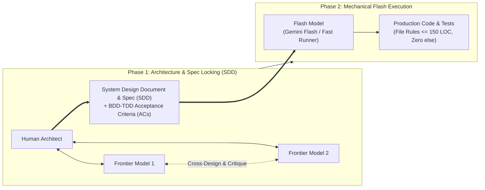

# AI Collaboration Narrative: Unified Service Scheduler

> **SSOT on Human-GenAI Engineering Collaboration**  
> Formatted in accordance with Keyloop Technical Assessment criteria (Scenario A: The Unified Service Scheduler).

---

## 1. Metadata & Role Assignment (The Human-AI Contract)

| Field | Specification |
| :--- | :--- |
| **Human Architect:** | Huy (Lead Architect & Sole Reviewer) |
| **Frontier Cross-Design Partners:** | 2 Frontier Models (Adversarial Architectural Review & BDD-TDD Invariants) |
| **Execution Runner:** | Flash Model (Rapid Code Generation & Test Suite Builder) |
| **Operational SSOT:** | [`AGENTS.md`](../AGENTS.md) (File-level guardrails & coding constraints) |
| **Core Philosophy:** | *"Workflow and rules — coding style by file."* |
| **Execution Architecture:** | **Triad Cross-Design → Spec-Driven Development (SDD) & BDD-TDD → Flash Implementation** |
| **Status:** | Finalized & Verified |

---

## 2. High-Level Guiding Strategy

*Addressing Keyloop Question 1: "Describe your high-level strategy for guiding the AI"*

Empirical engineering demonstrates two failure modes in GenAI workflows:
1. **Interactive "grill-me" interviews** waste excessive human engineering time without producing hard invariants.
2. **Unconstrained single-model generation** yields shallow architectures, naive concurrency models, and theoretical "AI slop."

To achieve production-grade quality, the workflow enforced a tiered **Spec-Driven Development (SDD)** pipeline:



### 2.1. Tiered Model Allocation
1. **Frontier Models for Cross-Design & Specification (SDD):**
   - Two independent top-tier frontier models cross-examined architectural trade-offs alongside the Human Architect.
   - Identified edge cases in dual-resource allocation, database lock contention, and relation normal forms.
   - **Mandatory Output:** A locked **System Design Document (SDD)** defining all domain entities, OpenAPI 3.0 contracts, and BDD-TDD Acceptance Criteria before any application code was written.
2. **Flash Model for Mechanical Implementation & Testing:**
   - Code generation and test scaffolding were delegated to a high-speed Flash model.
   - Constrained by file-level invariants in `AGENTS.md` to prevent architectural drift.
3. **Proprietary Prompt Harness:**
   - Project-specific skills and validation hooks automated linter verification, test execution, and context budget management.

### 2.2. File-Level Architectural Guardrails (Coding Style by File)
To eliminate context bloating and heuristic hallucination, code was organized into strict **Vertical Slices** with collocated files in `src/features/scheduling/`:
- `*.contract.ts` (40–120 LOC): Zod schemas, branded types, domain error unions. **Zero logic.**
- `*.rules.ts` (80–130 LOC): Pure functions (half-open interval math, qualification policy). **Zero I/O.**
- `*.storage.ts` (80–145 LOC): Imperative shell (PostgreSQL connection pool, `SELECT ... FOR UPDATE` transactions, DDL).
- `*.router.ts` (60–120 LOC): Thin Fastify HTTP adapters with fail-fast Zod validation.
- `index.ts` (10–25 LOC): Selective facade (strictly zero `export *`).
- **Hard Constraints:** Maximum 150 lines per file, Clean Flow (**Zero `else`**, early returns only), and Cyclomatic Complexity $\le 5$.

---

## 3. Verification, Debugging & Refinement Process

*Addressing Keyloop Question 2: "Describe your process for verifying and refining its output"*

Verification was governed by **Active Human Skepticism** and recorded as empirical feedback loops where human intervention corrected AI bias:

| Engineering Scenario | Initial AI Proposal (Failure / Bias) | Human Intervention (Refinement) | Verifiable Acceptance Evidence |
| :--- | :--- | :--- | :--- |
| **Actor & Intake Modeling** | Legacy DMS bias: Assumed only internal workshop advisors book appointments. | Expanded to Dual-Channel: B2C Car Owner self-booking + Advisor walk-in/call intake. Established *"Good dealership remembers client's taste"* philosophy. | OpenAPI contract separates public and internal flows; vehicle identifier softened for legacy DMS interoperability. |
| **Codebase Architecture** | Proposed horizontal waterfall layers (`controllers/`, `services/`, `models/`, `utils/`). | Blocked immediately. Enforced Vertical Slice Architecture and collocated quartet pattern. | All scheduling lifecycle code lives self-contained within `src/features/scheduling/`. |
| **Double-Booking Prevention** | Suggested naive application-level check (`SELECT` then `INSERT`), vulnerable to race conditions. | Enforced transaction-scoped advisory locks (`pg_advisory_xact_lock`) and row-level locks (`SELECT ... FOR UPDATE`) in PostgreSQL storage, while proving the double-booking invariant with an in-memory concurrency test suite. | Automated in-memory stress test (`scheduling.concurrency.test.ts`) firing 10 concurrent requests at the same millisecond proves exactly 1 succeeds (`201`), 9 receive `409 Conflict`. |
| **Database Realism** | AI attempted to downgrade storage to in-memory SQLite to avoid setting up a real database. | Rejected. Mandated PostgreSQL 16 schema with `docker-compose.yml` to mirror enterprise DMS production environments. | C4 diagram, DDL migrations, and Drizzle storage use native PostgreSQL transactions with row-level locks. |
| **Degraded Endpoint Bug** | AI stubbed `/api/v1/availabilities` with hardcoded empty array `[]` and added an overly strict date filter that broke past test dates. | Removed the artificial date filter, restored calendar integrity, and wired the endpoint directly to `AvailabilityService.getAvailableSlots()`. | 100% of test suites pass (45/45); real cURL returns 20 computed slots. |

---

## 4. Ensuring Final Code Quality

*Addressing Keyloop Question 3: "How you ensured the final quality of the code"*

Quality was guaranteed deterministically through **Spec-Driven Development** and the **3-Gate Protocol**:

### 4.1. SDD as an Immutable Quality Contract
* **Single Source of Truth:** Application code maps 1:1 to the System Design Document:
  - **API Contract:** Strictly conforms to OpenAPI 3.0 schemas (`/api/v1/availability`, `/api/v1/appointments/book`, `/api/v1/vehicles/:vehicleVin/appointments`).
  - **Relational Schema:** 5 normalized tables (`dealerships`, `service_bays`, `technicians`, `technician_skills`, `appointments`) with foreign keys and check constraints.
  - **Result Pattern:** All fallible functions return explicit tagged unions `Result<SuccessData, DomainError>` rather than throwing untyped exceptions.

### 4.2. BDD-TDD Acceptance Criteria
* Core invariants were locked in behavioral tests prior to implementation:
  1. *Dual-Resource Invariant:* A booking requires both a physical bay and a technician with matching skill certification (e.g., `HIGH_VOLTAGE_EV` for EV services).
  2. *Half-Open Interval Adjacency:* Math `max(S1, S2) < min(E1, E2)` ensures consecutive bookings (`08:30–09:00` and `09:00–09:30`) never falsely collide.
  3. *Concurrency Invariant:* High-concurrency conflict test proves zero double-booking under load (`COUNT(*) = 1`).

### 4.3. The Fresh Clone Standard
* Any reviewer cloning this repository can verify the entire test suite in seconds without external dependencies:
  ```bash
  pnpm test
  ```
  **12 test suites, 45 tests — 100% PASS.**
* **Production Observability:** Pino structured JSON logging with correlation IDs (`requestId`, `durationMs`, `outcome`) and an operational `GET /health` probe verifying database connectivity.
