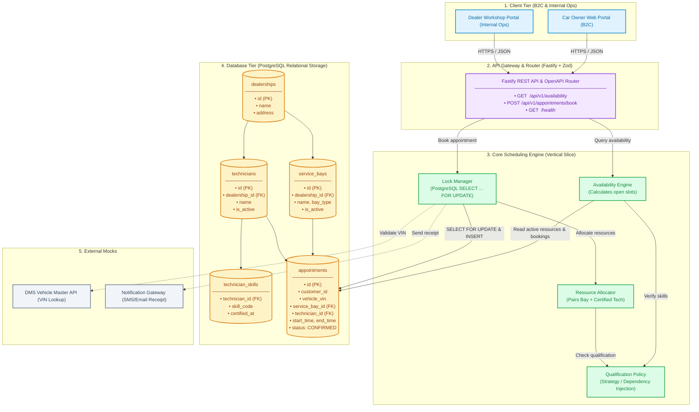

# 🚗 Unified Service Scheduler — System Design Document (v7)

A resource-constrained service appointment scheduling platform (**Scenario A: The Unified Service Scheduler**, Domain: Ownership).

---

## 1. 📋 Problem & Domain Context

Car dealership service departments operate under strict physical and technical resource constraints. Unlike generic appointment booking systems (which only track time calendar slots), automotive service scheduling requires **two physical resources simultaneously**:

1. **A Service Bay (Lift / Stall):** A physical work area equipped for vehicle maintenance.
2. **A Certified Technician:** A qualified specialist possessing the specific skill certification required for the requested service.

### 👥 Primary Actors
- 🚘 **Car Owner (B2C Touchpoint):** Self-service customer booking appointments online via web or mobile portal.
- 📋 **Service Advisor (Internal Workshop Ops):** Dealership staff managing walk-in, phone-in, and scheduled repair workflows.

### 💡 Client Recognition & Vehicle Identifier Philosophy
> *"A good dealership remembers clients' tastes."*
> As soon as you pick up a client's phone call, you should immediately know who that is, their `customerId`, and their `vehicleId`. 
> Given the reality of diverse legacy DMS integrations, `vehicleId` in this scheduler demo is treated as a broad term (an inclusive, opaque identifier) rather than enforcing rigid format validation (such as strict 17-character ISO 3779 VIN rules).

### 🔧 Standard Services & Skill Certifications

| Service Type (`serviceType`) | Duration | Required Skill Certification (`skillCode`) |
| :--- | :---: | :--- |
| `OIL_CHANGE` | 30 min | `GENERAL_MAINTENANCE` |
| `TIRE_ROTATION` | 30 min | `GENERAL_MAINTENANCE` |
| `BRAKE_INSPECTION` | 45 min | `BRAKE_SYSTEMS` |
| `ENGINE_DIAGNOSTIC` | 60 min | `ENGINE_ADVANCED` |
| `BATTERY_EV_SERVICE` | 90 min | `HIGH_VOLTAGE_EV` |

### 📐 Core Domain Invariants
- 🔒 **Dual-Resource Invariant:** A booking is valid if and only if **both** an active `ServiceBay` and a qualified `Technician` with matching certifications are available for the entire service duration.
- ⏱️ **Half-Open Interval Math:** Time intervals are treated as half-open `[start, end)`. A booking ending at `09:00` does not clash with another starting at `09:00`. Two slots clash if and only if: `max(start1, start2) < min(end1, end2)`.
- 🚫 **Atomic Concurrency Control (Zero Double-Booking):** When two customers attempt to book the last remaining slot concurrently, the transaction serializes at the database layer via PostgreSQL row-level locks (`SELECT ... FOR UPDATE`). Exactly one request succeeds (`201 Created`); competing requests receive `409 Conflict` with immediate feedback.

---

## 2. 🏛️ System Architecture



---

## 3. 🧩 Components

| Component | Layer | Role |
| :--- | :--- | :--- |
| 💻 **Web Portal** | Client | Self-service UI for car owners and internal workbench for service advisors. |
| 🚪 **API Gateway** | Ingress | Fastify HTTP server validating payloads with Zod schemas and routing requests. |
| ⏱️ **Availability Engine** | Core | Computes open appointment slots based on service duration and active calendar bookings. |
| 🤝 **Resource Allocator** | Core | Evaluates candidate slots and pairs 1 free service bay with 1 certified technician. |
| 🎓 **Qualification Policy** | Core | Strategy implementation verifying required technical skill certifications (e.g., EV High Voltage). |
| 🔐 **Lock Manager** | Storage | Enforces atomic write transactions via PostgreSQL row-level locks (`SELECT ... FOR UPDATE`). |
| 🗄️ **Database (PostgreSQL)** | Storage | Relational source of truth for dealerships, bays, technicians, certifications, and appointments. |
| 📡 **External Mocks** | External | Mocked integrations for DMS VIN lookups and customer notification receipts. |

---

## 4. 🔄 How the System Works

### 🔍 1. Finding Available Slots (Read Path)
1. **Request:** Client queries `GET /api/v1/availability` with `dealershipId`, `serviceType`, `date`, and `vehicleVin`.
2. **Lookup:** Engine retrieves service duration (e.g., `OIL_CHANGE` = 30m) and queries PostgreSQL for existing appointments on the target date.
3. **Filter:** Matches available technicians against required skill certifications via `QualificationPolicy`.
4. **Result:** Returns all valid time intervals where at least 1 bay AND 1 qualified technician are simultaneously free (`200 OK`).

### ✍️ 2. Booking an Appointment (Atomic Write Path)
1. **Request:** Client submits `POST /api/v1/appointments/book` with booking details.
2. **Lock:** Storage opens a PostgreSQL transaction and executes `SELECT ... FOR UPDATE` on candidate bay and technician schedules to serialize concurrent attempts.
3. **Verify:** Checks if the target resources remain unassigned for the requested interval:
   - ❌ **Conflict:** Rolls back transaction immediately → Returns `409 Conflict` → Client UI refreshes with updated available slots.
   - ✅ **Available:** Inserts booking record with status `CONFIRMED` linking customer, vehicle, bay, and technician → Commits transaction → Returns `201 Created`.

---

## 5. 🛠️ Tech Stack & Architectural Rationale (Why We Chose It)

| Layer | Choice | Key Rationale & Production Justification |
| :--- | :--- | :--- |
| 🗄️ **Database** | **PostgreSQL 16 (Docker / pg)** | Native row-level locking (`SELECT ... FOR UPDATE`), distributed ACID transaction serialization across multi-instance pods, and support for GiST temporal range exclusion constraints (`tsrange`), eliminating race conditions without file-lock bottlenecks. |
| 🟦 **Language & Runtime** | **TypeScript 5 + Node.js 22 LTS** | End-to-end compile-time type safety with branded types and discriminated tagged unions (`Result<T, DomainError>`); Node 22 LTS provides long-term operational stability and native ESM without native compilation fragility. |
| ⚡ **HTTP Framework** | **Fastify v5** | ~2x faster than Express via custom Radix Tree routing, first-class Zod validation lifecycle integration, and encapsulated plugin architecture matching Vertical Slice modularity. |
| 🛡️ **Boundary Validation** | **Zod** | Single source of truth (SSOT) unifying runtime request validation with static TypeScript type inference (`z.infer`), rejecting malformed payloads before database locks are acquired. |
| 🧪 **Test Runner** | **Vitest** | Native ESM/TypeScript execution with near-instant cold start; deterministic concurrent test runner (`Promise.all`) specifically built for race condition stress tests. |
| 📝 **Observability** | **Pino** | High-performance, non-blocking structured JSON logger bundled with Fastify; automatically injects correlation IDs (`requestId`) for distributed request tracing. |

### 5.1. PostgreSQL 16 (vs. SQLite / NoSQL)
- **Distributed Row Locks:** `SELECT ... FOR UPDATE` serializes competing bookings across multi-pod API instances, eliminating SQLite's single-file lock (`BEGIN IMMEDIATE`) bottleneck.
- **Atomic Dual-Resource Invariant:** Strict ACID transaction guarantees an appointment commits if and only if both bay and certified technician are available; rolls back cleanly on any conflict.
- **Enterprise DMS Standard:** Native relational schema directly mirrors production dealership management systems managing VINs, bays, and labor records.

### 5.2. TypeScript 5 + Node.js 22 LTS
- **High-Signal Contracts:** Branded types (`DealershipId`, `ServiceBayId`) and tagged union errors (`Result<AllocatedResources, DomainError>`) eliminate silent runtime type coercion.
- **LTS Stability:** Node 22 LTS provides stable native ESM without C++ build toolchain (`node-gyp`) breakage seen on bleeding-edge Node releases.

### 5.3. Fastify v5 (vs. Express)
- **High Throughput:** Radix Tree router (`find-my-way`) delivers ~2x higher throughput than Express for high-frequency availability queries.
- **Vertical Slice Encapsulation:** Plugin architecture encapsulates schemas, routes, and error mappers within feature slices with zero global scope pollution.
- **Native Pino Logger:** Zero-overhead structured JSON logging automatically correlates `requestId`, `durationMs`, and outcome.

### 5.4. Zod Boundary Validation
- **Single Source of Truth:** Infers static TypeScript types (`z.infer`) directly from runtime schemas, eliminating contract drift.
- **Fail-Fast Boundary:** Rejects malformed VINs, timestamps, or service enums with HTTP 400 at ingress before touching database connections or acquiring locks.

### 5.5. Vitest
- **Near-Instant Cold Start:** Native ESM runner powered by Vite's transform pipeline, removing `ts-jest` transpilation lag.
- **Deterministic Concurrency Harness:** Native `Promise.all` execution dispatches 10 simultaneous requests to empirically verify PostgreSQL row-level locks (`COUNT(*) = 1`).

---

## 6. 📊 Observability Strategy

- 📝 **Structured Logging (Pino JSON):** Every HTTP request emits a structured JSON line containing `requestId`, `dealershipId`, `durationMs`, and `outcome` (`CONFIRMED`, `CONFLICT`, `ERROR`).
- 📈 **Operational Metrics:**
  - `conflict_rate`: Tracks frequency of HTTP `409 Conflict` responses to signal workshop capacity saturation.
  - `lock_time_ms`: Measures PostgreSQL transaction hold time (target under 30ms to prevent connection pool exhaustion).
- 💓 **Health Check:** `GET /health` executes a `SELECT 1` ping against the PostgreSQL connection pool to verify end-to-end database readiness.

---

## 7. 🏁 Vertical Feature Tasks (AI Checkpoints)

Each task is an end-to-end **Vertical Slice** cutting through Route → Logic → Storage, mapped directly to concrete domain contracts, pure functions, and PostgreSQL transactions. Completing each task serves as a verified checkpoint with **explicit inputs/outputs and verifiable acceptance criteria**:

---

### 📍 Task 1: Real-Time Slot Availability (`GET /api/v1/availability`)

* **Contract & Schema (`AvailabilityQuerySchema`):**
  ```typescript
  export const ServiceTypeEnum = {
    OIL_CHANGE: 'OIL_CHANGE',
    BRAKE_INSPECTION: 'BRAKE_INSPECTION',
    TIRE_ROTATION: 'TIRE_ROTATION',
    ENGINE_DIAGNOSTIC: 'ENGINE_DIAGNOSTIC',
    BATTERY_EV_SERVICE: 'BATTERY_EV_SERVICE',
  } as const;

  export type ServiceType = (typeof ServiceTypeEnum)[keyof typeof ServiceTypeEnum];

  export const AvailabilityQuerySchema = z.object({
    dealershipId: z.string().min(1, 'Dealership ID is required'),
    vehicleVin: z.string().min(11, 'Invalid VIN format'),
    serviceType: z.nativeEnum(ServiceTypeEnum),
    date: z.string().regex(/^\d{4}-\d{2}-\d{2}$/, 'Date must be YYYY-MM-DD'),
  });

  export type AvailabilityQueryInput = z.infer<typeof AvailabilityQuerySchema>;
  ```

* **Durations & Required Skill Certifications:**
  ```typescript
  export const SERVICE_DURATIONS_MINUTES: Record<ServiceType, number> = {
    [ServiceTypeEnum.OIL_CHANGE]: 30,
    [ServiceTypeEnum.TIRE_ROTATION]: 30,
    [ServiceTypeEnum.BRAKE_INSPECTION]: 45,
    [ServiceTypeEnum.ENGINE_DIAGNOSTIC]: 60,
    [ServiceTypeEnum.BATTERY_EV_SERVICE]: 90,
  };

  export const REQUIRED_SKILLS_FOR_SERVICE: Record<ServiceType, readonly string[]> = {
    [ServiceTypeEnum.OIL_CHANGE]: ['GENERAL_MAINTENANCE'],
    [ServiceTypeEnum.TIRE_ROTATION]: ['GENERAL_MAINTENANCE'],
    [ServiceTypeEnum.BRAKE_INSPECTION]: ['BRAKE_SYSTEMS'],
    [ServiceTypeEnum.ENGINE_DIAGNOSTIC]: ['ENGINE_ADVANCED'],
    [ServiceTypeEnum.BATTERY_EV_SERVICE]: ['HIGH_VOLTAGE_EV'],
  };
  ```

* **Pure Rules Functions (`scheduling.rules.ts`):**
  - **End Time Calculation:**
    ```typescript
    export function calculateEndTime(startTime: Date, serviceType: ServiceType): Date {
      const durationMs = SERVICE_DURATIONS_MINUTES[serviceType] * 60 * 1000;
      return new Date(startTime.getTime() + durationMs);
    }
    ```
  - **Interval Overlap Mathematics:**
    ```typescript
    export function isTimeOverlapping(slotA: TimeSlot, slotB: TimeSlot): boolean {
      const maxStart = Math.max(slotA.startTime.getTime(), slotB.startTime.getTime());
      const minEnd = Math.min(slotA.endTime.getTime(), slotB.endTime.getTime());
      return maxStart < minEnd; // Contiguous slots [08:00, 09:00) and [09:00, 10:00) return false
    }
    ```
  - **Qualification Policy Strategy:**
    ```typescript
    export function isTechnicianQualified(
      skills: readonly string[],
      serviceType: ServiceType,
      vehicleVin?: string
    ): boolean {
      const isEvVehicle = Boolean(vehicleVin && (vehicleVin.startsWith('EV') || vehicleVin.includes('_EV')));
      const requiresEv = serviceType === ServiceTypeEnum.BATTERY_EV_SERVICE || isEvVehicle;
      if (requiresEv && !skills.includes('HIGH_VOLTAGE_EV')) return false;
      const baseRequired = REQUIRED_SKILLS_FOR_SERVICE[serviceType] ?? [];
      return baseRequired.every((requiredSkill) => skills.includes(requiredSkill));
    }
    ```
  - **Daily Availability Matrix Scanner:**
    ```typescript
    export function findAvailableDaySlots(input: DaySlotQueryInput): readonly AvailableTimeSlot[];
    ```

* **Concrete Acceptance Test:**
  - **Setup:** Dealership `D01` has 2 Bays (`BAY-01`, `BAY-02`) and 2 Technicians (`TECH-01`: `GENERAL_MAINTENANCE`; `TECH-02`: `HIGH_VOLTAGE_EV`). An existing appointment occupies `BAY-01` from `08:00` to `08:30`.
  - **Command:**
    ```bash
    curl -s "http://127.0.0.1:3000/api/v1/availability?dealershipId=D01&serviceType=OIL_CHANGE&date=2026-11-03&vehicleVin=1HGCR2F83HA000000"
    ```
  - **Expected Output:**
    - HTTP `200 OK` with JSON array of available time slots.
    - Slot `08:30–09:00` is **present** (proves adjacent slot does not falsely clash).
    - Querying `BATTERY_EV_SERVICE` when `TECH-02` is on leave returns **empty array `[]`** (proves dual-resource rule: an open bay alone without a certified tech cannot be booked).

---

### 📍 Task 2: Atomic Service Booking (`POST /api/v1/appointments/book`)

* **Contract & Schema (`BookingRequestSchema`):**
  ```typescript
  export const BookingRequestSchema = z.object({
    customerId: z.string().min(1, 'Customer ID is required'),
    dealershipId: z.string().min(1, 'Dealership ID is required'),
    vehicleVin: z.string().min(11, 'Invalid VIN format'),
    serviceType: z.nativeEnum(ServiceTypeEnum),
    requestedStartTime: z.string().datetime(),
  });

  export type BookingRequestInput = z.infer<typeof BookingRequestSchema>;
  ```

* **Explicit Domain Error Unions (`Result<T, DomainError>`):**
  ```typescript
  export type DomainError =
    | { readonly code: 'BAY_UNAVAILABLE'; readonly message: string }
    | { readonly code: 'TECHNICIAN_UNAVAILABLE'; readonly message: string }
    | { readonly code: 'SKILL_MISMATCH'; readonly message: string }
    | { readonly code: 'INVALID_TIME_SLOT'; readonly message: string }
    | { readonly code: 'SLOT_ALREADY_BOOKED'; readonly message: string };
  ```

* **Pure Resource Allocator (`evaluateResourceAllocation`):**
  ```typescript
  export function evaluateResourceAllocation(
    input: ResourceAllocationInput
  ): Result<AllocatedResources, DomainError>;
  // Pure function, Cyclomatic Complexity <= 5, Zero else
  ```

* **Storage Transaction (`bookAppointmentTransaction`):**
  Executes in a single PostgreSQL ACID transaction:
  ```sql
  BEGIN;
  -- Lock existing bookings covering requested interval for candidate bay and technician
  SELECT id FROM appointments
  WHERE dealership_id = $1
    AND (service_bay_id = $2 OR technician_id = $3)
    AND (start_time < $5 AND end_time > $4)
  FOR UPDATE;

  -- Insert confirmed appointment if no row conflicts
  INSERT INTO appointments (id, customer_id, dealership_id, vehicle_vin, service_bay_id, technician_id, service_type, start_time, end_time, status)
  VALUES ($1, $2, $3, $4, $5, $6, $7, $8, $9, 'CONFIRMED');
  COMMIT;
  ```

* **Concrete Acceptance Test:**
  - **Command:**
    ```bash
    curl -s -X POST "http://127.0.0.1:3000/api/v1/appointments/book" \
      -H "Content-Type: application/json" \
      -d '{
        "customerId": "CUST-01",
        "dealershipId": "D01",
        "vehicleVin": "1HGCR2F83HA000000",
        "serviceType": "OIL_CHANGE",
        "requestedStartTime": "2026-11-03T09:00:00.000Z"
      }'
    ```
  - **Expected Output:**
    - HTTP `201 Created`.
    - Response JSON: `{ "status": "CONFIRMED", "serviceBayId": "BAY-01", "technicianId": "TECH-01" }`.
    - PostgreSQL database verification:
      ```bash
      psql -h 127.0.0.1 -U postgres -d scheduler -c "SELECT status, service_bay_id, technician_id FROM appointments WHERE customer_id = 'CUST-01';"
      ```
      Returns exactly: `CONFIRMED|BAY-01|TECH-01`.

---

### 📍 Task 3: Anti-Double-Booking Concurrency Guard (`409 Conflict`)

* **Error Mapping & RFC 7807 Payload:**
  When `SELECT ... FOR UPDATE` detects an existing overlapping booking during transaction serialization, transaction rolls back immediately:
  ```typescript
  return Result.err({
    code: 'SLOT_ALREADY_BOOKED',
    message: 'The requested time slot has already been booked by another customer',
  });
  ```
  Fastify error mapper transforms `SLOT_ALREADY_BOOKED` into HTTP `409 Conflict`:
  ```json
  {
    "statusCode": 409,
    "error": "Conflict",
    "code": "SLOT_ALREADY_BOOKED",
    "message": "The requested time slot has already been booked by another customer"
  }
  ```

* **Concrete Acceptance Test:**
  - **Setup:** Only 1 Bay and 1 Tech are free for slot `2026-11-03T10:00:00.000Z`.
  - **Command:** Execute automated concurrency stress test firing **10 parallel requests** at the exact same millisecond:
    ```bash
    pnpm test tests/scheduling.concurrency.test.ts
    ```
  - **Expected Output:**
    - **Exactly 1 request** receives HTTP `201 Created`.
    - **Exactly 9 requests** receive HTTP `409 Conflict` with `{ "code": "SLOT_ALREADY_BOOKED" }`.
    - PostgreSQL database verification:
      ```bash
      psql -h 127.0.0.1 -U postgres -d scheduler -c "SELECT COUNT(*) FROM appointments WHERE start_time = '2026-11-03T10:00:00.000Z';"
      ```
      Returns strictly `1` (zero double-booking).

---

### 📍 Task 4: Observability, Health Check & Facade (`GET /health` & `index.ts`)

* **Selective Facade (`src/features/scheduling/index.ts`):**
  ```typescript
  export { schedulingPlugin } from './scheduling.router.js';
  export type {
    ConfirmedAppointment,
    AvailableTimeSlot,
    ServiceType,
  } from './scheduling.contract.js';
  // Strictly zero `export *`
  ```

* **Health Probe (`GET /health`):**
  Executes `SELECT 1` on the PostgreSQL connection pool. Returns `503 Service Unavailable` if database is unreachable.

* **Concrete Acceptance Test:**
  - **Command:**
    ```bash
    curl -s -i "http://127.0.0.1:3000/health"
    ```
  - **Expected Output:**
    - HTTP `200 OK` with `{ "status": "UP", "database": "HEALTHY" }`.
    - Stdout JSON log contains `"requestId"`, `"durationMs"`, and `"outcome": "CONFIRMED"`.
    - Type check & build: `pnpm exec tsc --noEmit` exits with code 0.
